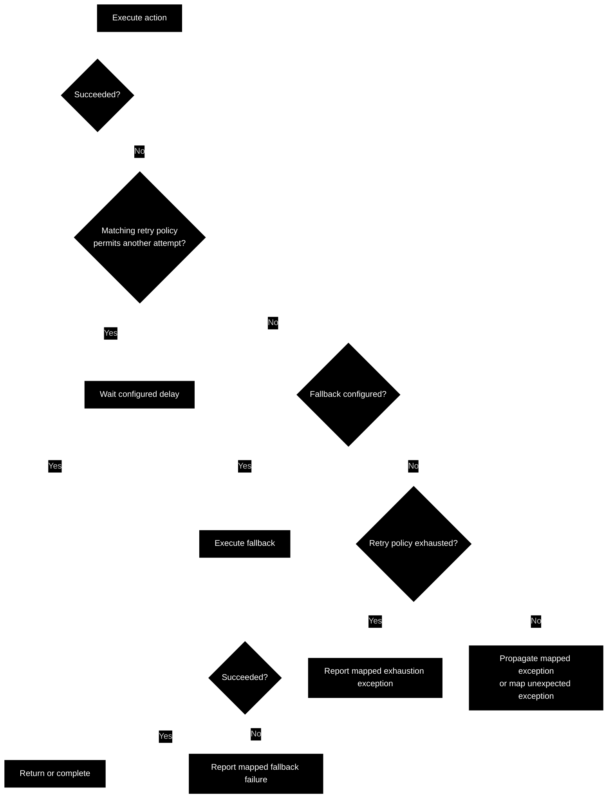

CAE Concept

---

 

### Clean Trier

This concept defines a common way to execute an action with explicit failure-handling rules.

The **Trier** coordinates four decisions: whether to retry the action, whether to execute a fallback, how to represent retry exhaustion, and how to map unexpected exceptions.

For example, a remote call might be retried after a timeout, replaced by a cache lookup if recovery fails, or reported through a [mapped exception](https://github.com/clean-arch-enablers-project/clean-mapped-exceptions/blob/feature/hello-world/concept/README.md) when no acceptable result can be obtained.

 

#### Standalone Use

The Trier is a standalone component that application code can import and call directly. Its use does not require a surrounding application framework, a dependency injection container, or a framework-managed execution lifecycle.

The caller supplies the action and the desired failure-handling rules through the Trier's APIs, then invokes it where that behavior is needed. The same component can be used in a script, a command-line tool, or a framework-based application.

This keeps failure handling locally available and explicitly controlled by the calling code.

 

#### Action

The action is supplied as a parameter to the Trier, using a callable with one of four input and output shapes:

- **Function:** receives input and produces output.
- **Consumer:** receives input without producing output.
- **Supplier:** produces output without receiving input.
- **Runnable:** neither receives input nor produces output.

The caller passes the executable behavior directly, such as a lambda or a reference to an existing function or method. No Trier subclass or inherited action implementation is required.

When the supplied action succeeds, the Trier returns the action's result or simply completes. When the action throws an exception, the Trier applies the configured failure-handling rules.

 

#### Exception Mapping

Mapping gives a failure its semantic meaning within the workflow. It produces an exception for the caller to handle.

A **[mapped exception](https://github.com/clean-arch-enablers-project/clean-mapped-exceptions/blob/feature/hello-world/concept/README.md)** already carries that meaning. If no recovery applies, the Trier propagates it unchanged.

An **unexpected exception** has not been mapped. If no recovery applies, the Trier passes it to a handler that produces an appropriate [mapped exception](https://github.com/clean-arch-enablers-project/clean-mapped-exceptions/blob/feature/hello-world/concept/README.md), preserving the original cause.

Here, unexpected means unmapped. A foreseeable technical failure, such as a timeout, may still require mapping.

 

#### Retry

A retry executes the **same action again** after a matching failure.

The Trier's retry policy defines:

- The failures eligible for retry
- The maximum number of additional attempts
- The delay before each additional attempt

Three retries allow up to four attempts: the initial execution and three additional executions. Delays may increase between attempts, such as through exponential backoff.

Each Trier invocation tracks its own retry attempts. Repeating the action must also be acceptable for its possible side effects, including when an earlier attempt partially succeeded.

 

#### Exhaustion

Exhaustion is the outcome of a retry policy permitting no further attempts after a failure.

An exhaustion handler receives the triggering exception and retry context, and produces a [mapped exception](https://github.com/clean-arch-enablers-project/clean-mapped-exceptions/blob/feature/hello-world/concept/README.md) describing that outcome. The exhaustion handler defines how retry exhaustion is reported; it does not recover a result.

If a fallback is configured, it is attempted before exhaustion is reported. Without a fallback, the Trier uses the custom exhaustion handler or a default mapped exhaustion exception.

A failure with no matching retry policy is handled directly; it is not retry exhaustion.

 

#### Fallback

A fallback executes a **different action** to provide an acceptable outcome after the original action fails.

The fallback runs when no retry policy applies or when the applicable retries are exhausted. A successful fallback supplies the result returned by the Trier.

For example, a cache lookup can replace a failed remote retrieval when the workflow accepts potentially older information.

If the fallback also fails, the Trier reports a mapped fallback failure retaining both the fallback exception and the failure that triggered it.

 

#### Execution Order

The handling sequence is:

1. Execute the original action. Return on success.
2. On failure, retry if a matching policy permits another attempt.
3. When no retry remains or applies, execute the fallback if configured. Return on success; report a mapped fallback failure if it fails.
4. Without a fallback, report exhaustion if a retry policy was exhausted. Otherwise, propagate an already [mapped exception](https://github.com/clean-arch-enablers-project/clean-mapped-exceptions/blob/feature/hello-world/concept/README.md) or map an unexpected one.

Retries and fallback are optional. Exception mapping remains useful on its own to define how failures leave the execution boundary.

The Trier's retry, fallback, exhaustion, and exception-mapping semantics are intended to be reusable across workflows, programming languages, and application frameworks.

 
 

---

clean software, made easy.

